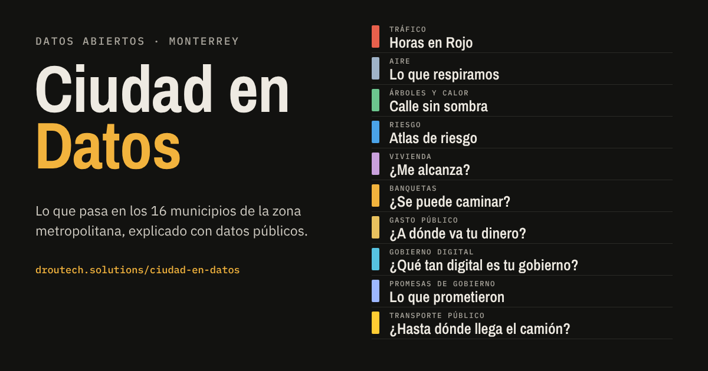

  

<h3 align="center">Lo que pasa en tu ciudad, explicado con datos públicos.</h3>

  <a href="https://droutech.solutions/ciudad-en-datos/"><b>Ver los 10 proyectos</b></a>
  &nbsp;·&nbsp;
  <a href="https://github.com/droutech-solutions/ciudad-en-datos/issues/new?template=replicar.yml"><b>Llévalo a tu ciudad</b></a>
  &nbsp;·&nbsp;
  <a href="https://github.com/droutech-solutions/ciudad-en-datos/issues/new?template=pregunta.yml"><b>Propón una pregunta</b></a>

---

El tráfico, el calor, las banquetas, el camión, lo que se prometió en campaña. Todos tenemos una queja de la ciudad donde vivimos. **Ciudad en Datos** convierte esas quejas en preguntas que se contestan con un mapa, una cifra y su fuente.

Son 10 proyectos sobre los 16 municipios de la Zona Metropolitana de Monterrey, hechos solo con datos públicos. Cada cifra dice de dónde sale, de qué fecha es y qué no alcanza a decir.

## Los 10 proyectos

| | Proyecto | La pregunta | Fuentes principales |
|---|---|---|---|
| 1 | [**Horas en Rojo**](https://droutech.solutions/horas-en-rojo-monterrey) | ¿Cuánto tiempo pierdes en el tráfico? | TomTom Traffic Index, Así Vamos, INEGI, OpenStreetMap |
| 2 | [**Lo que respiramos**](https://droutech.solutions/lo-que-respiramos-monterrey) | ¿Qué tan limpio está el aire que respiras? | SINAICA (INECC), SIMA Nuevo León |
| 3 | [**Calle sin sombra**](https://droutech.solutions/calle-sin-sombra-monterrey) | ¿Cuántos árboles tiene tu colonia y qué tan caliente se pone? | ESA WorldCover, Landsat (NASA y USGS), INEGI |
| 4 | [**Atlas de riesgo**](https://droutech.solutions/atlas-de-riesgo-monterrey) | ¿Tu colonia está junto a un río o en una ladera? | Copernicus DEM, CENAPRED, INEGI, atlas de riesgo municipales |
| 5 | [**¿Me alcanza?**](https://droutech.solutions/me-alcanza-monterrey) | ¿Alcanza el sueldo para comprar una casa? | IMSS, ENOE (INEGI), SHF, SNIIV (SEDATU) |
| 6 | [**¿Se puede caminar?**](https://droutech.solutions/se-puede-caminar-monterrey) | ¿Tu calle tiene banqueta, rampa y alumbrado? | Inventario Nacional de Vivienda y ATUS (INEGI), Project Sidewalk, Mapillary |
| 7 | [**¿A dónde va tu dinero?**](https://droutech.solutions/a-donde-va-tu-dinero-monterrey) | ¿Cuánto gasta tu gobierno y en qué? | EFIPEM e INPC (INEGI) |
| 8 | [**¿Qué tan digital es tu gobierno?**](https://droutech.solutions/que-tan-digital-monterrey) | ¿Qué puedes resolver en línea y quién monitorea a quien nos monitorea? | Portales oficiales de los 16 municipios y del estado, CIDE, INEGI |
| 9 | [**Lo que prometieron**](https://droutech.solutions/lo-que-prometieron-monterrey) | ¿Qué cumplieron los gobiernos de lo que prometieron? | Planes de desarrollo e informes de gobierno |
| 10 | [**¿Hasta dónde llega el camión?**](https://droutech.solutions/hasta-donde-llega-el-camion-monterrey) | ¿Quién vive lejos de una parada? | Instituto de Movilidad de Nuevo León, INEGI, DENUE, CLUES, OpenStreetMap |

## Llévalo a tu ciudad

La mayoría de estas fuentes existen para todo México. Lo que se hizo en Monterrey se puede repetir en tu ciudad.

Los datos procesados y los scripts de cada proyecto no están publicados aquí. **Se comparten con quien quiera replicarlo.** Cuéntanos tu ciudad y qué proyecto te interesa, y te contactamos.

<table>
  <tr>
    <td width="33%" valign="top">
      <h3><a href="https://github.com/droutech-solutions/ciudad-en-datos/issues/new?template=replicar.yml">Quiero replicarlo en mi ciudad</a></h3>
      Dinos qué ciudad y qué proyecto. Te compartimos los datos y los scripts.
    </td>
    <td width="33%" valign="top">
      <h3><a href="https://github.com/droutech-solutions/ciudad-en-datos/issues/new?template=pregunta.yml">Propón una pregunta</a></h3>
      ¿Qué te gustaría ver con datos de tu ciudad? Puede ser la siguiente pregunta.
    </td>
    <td width="33%" valign="top">
      <h3><a href="https://github.com/droutech-solutions/ciudad-en-datos/issues/new?template=error-dato.yml">Encontré un error en un dato</a></h3>
      Si una cifra no cuadra, dinos dónde y con qué fuente. Se revisa y se corrige.
    </td>
  </tr>
</table>

> [!NOTE]
> Lo que escribas aquí es público. Si prefieres hablar en privado, escríbenos por [WhatsApp](https://wa.me/522281803663) o desde [droutech.solutions](https://droutech.solutions).

## Quién lo hace

Ciudad en Datos es un proyecto sin fines de lucro de [DrouTech Solutions](https://droutech.solutions), desde Monterrey.

[Sitio](https://droutech.solutions/ciudad-en-datos/) · [Instagram](https://www.instagram.com/droutech.solutions) · [Medium](https://medium.com/@droutech.solutions)
